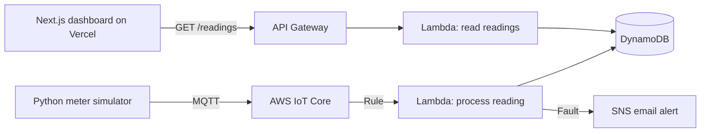

# Smart Energy Monitor

A live dashboard for a cloud-based smart electricity meter system. Simulated meters stream voltage, current, power factor and energy readings to AWS. The backend checks each reading for faults, and this dashboard shows the results in real time.

**Live demo:** https://energy-dashboard-lyart.vercel.app/

## What it shows

- A voltage gauge with the safe 200 to 250 V band marked
- Latest current, real power, power factor, energy used (kWh) and cost
- A fault log naming what tripped, with the threshold and time
- Voltage chart with the safe band shaded, and a current and power chart
- Auto-refresh every 6 seconds, with a status indicator for fault, normal, or no recent readings

## Fault rules

| Fault | Condition |
| --- | --- |
| Overvoltage | Voltage above 250 V |
| Undervoltage | Voltage below 200 V |
| Overload | Current above 20 A |
| Low power factor | Power factor below 0.85 |

## Architecture



1. A Python script simulates a smart meter and publishes readings over MQTT with certificate-based authentication.
2. An IoT Core rule forwards each reading to a Lambda function, which calculates power and cost, flags faults, stores the reading in DynamoDB, and sends an SNS email when a fault is found.
3. A second Lambda behind an API Gateway HTTP API returns the latest readings.
4. This Next.js app polls that API and renders the dashboard.

## Tech stack

- **Cloud:** AWS IoT Core, Lambda (Python), DynamoDB, SNS, API Gateway, CloudWatch
- **Frontend:** Next.js, React, Tailwind CSS, Recharts
- **Hosting:** Vercel
- **Simulator:** Python with the AWS IoT Device SDK

## Run locally

```bash
npm install
```

Create a `.env.local` file:

```
NEXT_PUBLIC_API_URL=https://your-api-id.execute-api.us-east-1.amazonaws.com
```

Then start the dev server and open http://localhost:3000:

```bash
npm run dev
```

## Deploy

Push to GitHub, import the repo in Vercel, and set `NEXT_PUBLIC_API_URL` under Environment Variables.

## Author

Joshua, B.Tech Electrical and Electronics Engineering, VIT Chennai
